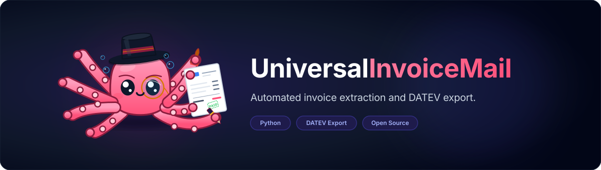
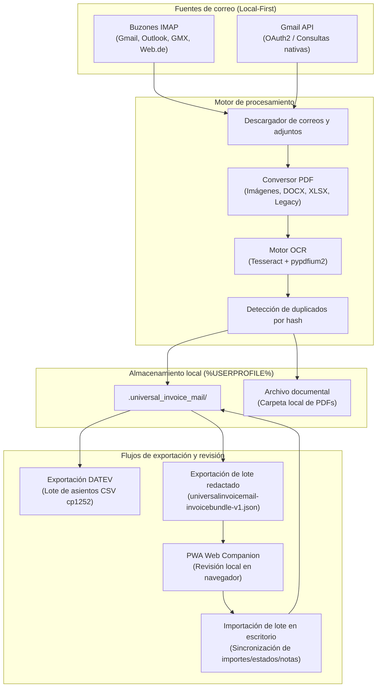

# UniversalInvoiceMail

[](https://github.com/doc-bricks)
[](https://github.com/open-bricks)
[](https://github.com/doc-bricks/UniversalInvoiceMail)
[](web_companion/)
[](https://www.python.org/)
[](#15-política-de-privacidad-y-protección-de-datos)
[](SECURITY.md)
[](SECURITY.md)
[](CONTRIBUTING.md)
[](https://astral.sh/ruff)
[](THIRD_PARTY_LICENSES.md)
[](NOTICE)
[](llms.txt)
[](MARKETING-LOG.txt)

[](LICENSE)

Herramienta de escritorio Windows local-first para recopilar facturas y recibos desde cuentas de correo electrónico, convertir archivos adjuntos a PDF, mantener un archivo privado y preparar exportaciones CSV compatibles con DATEV.

**[English](README.md)** | **[Deutsch](README-DE.md)** | **[Español](README_es.md)**

> [!NOTE]
> **Integración con IA / LLM:** El índice legible por máquina y el contexto arquitectónico están disponibles en [llms.txt](llms.txt).

---

### 🧭 Navegación rápida

- [1. Descripción general y razón de ser](#1-descripción-general-y-razón-de-ser)
- [2. Capacidades clave y arquitectura](#2-capacidades-clave-y-arquitectura)
- [3. Arquitectura visual y diagrama de flujo](#3-arquitectura-visual-y-diagrama-de-flujo)
- [4. Perfiles de usuario y detectabilidad](#4-perfiles-de-usuario-y-detectabilidad)
- [5. Matriz comparativa frente a alternativas](#5-matriz-comparativa-frente-a-alternativas)
- [6. Gobernanza e invariantes de ejecución](#6-gobernanza-e-invariantes-de-ejecución)
- [7. Fuentes de correo y procesamiento de adjuntos](#7-fuentes-de-correo-y-procesamiento-de-adjuntos)
- [8. Exportación contable e integración con DATEV](#8-exportación-contable-e-integración-con-datev)
- [9. Lotes redactados de revisión y Web Companion](#9-lotes-redactados-de-revisión-y-web-companion)
- [10. Guía de inicio rápido y ejecución](#10-guía-de-inicio-rápido-y-ejecución)
- [11. Almacenamiento local y gestión de perfiles](#11-almacenamiento-local-y-gestión-de-perfiles)
- [12. Dependencias opcionales y degradación elegante](#12-dependencias-opcionales-y-degradación-elegante)
- [13. Matriz del ecosistema doc-bricks](#13-matriz-del-ecosistema-doc-bricks)
- [14. Licencias de terceros y SBOM de nivel 1](#14-licencias-de-terceros-y-sbom-de-nivel-1)
- [15. Política de privacidad y protección de datos](#15-política-de-privacidad-y-protección-de-datos)
- [16. Política de seguridad, contactos y SLA de 48h](#16-política-de-seguridad-contactos-y-sla-de-48h)
- [17. Verificación y conjunto de pruebas automatizadas](#17-verificación-y-conjunto-de-pruebas-automatizadas)
- [18. Hoja de ruta, registro de cambios y aviso legal (§ 521 BGB)](#18-hoja-de-ruta-registro-de-cambios-y-aviso-legal--521-bgb)

---

## 1. Descripción general y razón de ser

UniversalInvoiceMail resuelve un problema administrativo crítico para autónomos, profesionales independientes, pequeñas empresas y asociaciones: **la fragmentación del correo entrante con facturas**.

En lugar de cargar credenciales y documentos confidenciales en plataformas en la nube de terceros, UniversalInvoiceMail funciona completamente en su máquina local:
1. **Recuperación automatizada:** Se conecta mediante IMAP cifrado o la API oficial de Gmail.
2. **Normalización documental:** Convierte imágenes, hojas de cálculo y correos electrónicos a formato PDF estándar mediante herramientas de procesamiento offline.
3. **Reconocimiento local:** Extrae importes, fechas y emisores mediante OCR offline (Tesseract y pypdfium2).
4. **Exportación DATEV:** Genera lotes de asientos contables (CSV cp1252) directamente listos para asesores contables o software fiscal.
5. **Revisión móvil:** Permite transferir lotes redactados (sin datos de acceso ni cuerpos de correo) para revisión en dispositivos móviles mediante una aplicación web progresiva (PWA) offline.

---

## 2. Capacidades clave y arquitectura

- **Local-First & Zero-Egress:** Ningún dato contable o documento de factura sale de su ordenador.
- **Seguridad en Windows:** Las contraseñas de las cuentas de correo se gestionan a través del Administrador de Credenciales de Windows (Keyring), eliminando el almacenamiento en texto claro.
- **Mapeo de cuentas SKR03 / SKR04:** Configuración flexible de cuentas contables, tipos impositivos y cuentas de contrapartida.
- **Durabilidad I/O atómica:** Escritura segura con archivos temporales y `fsync`, protegiendo la base de datos contra cortes de energía o fallos de disco.
- **CLI Headless para automatización:** Soporta integración directa en pipelines desatendidas mediante flags `--list-invoices`, `--export-csv`, `--export-bundle` y formato `--json`.

---

## 3. Arquitectura visual y diagrama de flujo



---

## 4. Perfiles de usuario y detectabilidad

- **Autónomos y freelancers:** Recopilan facturas de proveedores automáticamente sin intervención manual ni pagos mensuales de suscripción.
- **Pymes y comercios:** Centralizan múltiples buzones y descargan justificantes organizados por carpetas fiscales.
- **Asesorías y departamentos contables:** Reciben lotes formateados conforme a DATEV y reducen el tiempo de contabilización manual.

---

## 5. Matriz comparativa frente a alternativas

| Característica | UniversalInvoiceMail | Soluciones SaaS en la nube | Scripts ad-hoc |
|---|---|---|---|
| **Almacenamiento de datos** | 100% Local (%USERPROFILE%) | Servidores de terceros | Local no estructurado |
| **Protección de credenciales** | Windows Credential Manager | Servidor en la nube | Texto plano / Variables |
| **Conversión PDF integrada** | Sí (Local, multi-formato) | Variable | Rara vez disponible |
| **Exportación DATEV (SKR03/04)**| Sí (cp1252 validado) | A menudo de pago | Requiere codificación |
| **Revisión móvil sin nube** | Sí (PWA Offline Companion) | Requiere cuenta en la nube | No |
| **Coste recurrente** | 0 € (Código abierto MIT) | Cuota mensual | 0 € |

---

## 6. Gobernanza e invariantes de ejecución

UniversalInvoiceMail se rige por diez invariantes normativas innegociables:

1. **INV-LOCAL-01 (Local-First):** Ningún archivo de factura o dato contable se transmite a servidores externos.
2. **INV-CRED-02 (Keyring Security):** Los secretos de acceso nunca se persisten en texto claro en disco.
3. **INV-INTEG-03 (Detección de duplicados):** Los archivos duplicados se identifican mediante sumas de verificación SHA-256.
4. **INV-DATEV-04 (Cumplimiento contable):** La exportación DATEV genera archivos CSV con codificación cp1252 y validación estricta de formato.
5. **INV-PRIVACY-05 (Redacción de datos en intercambio):** Los lotes de intercambio para móviles no contienen credenciales, tokens ni cuerpos de correo.
6. **INV-DURABLE-06 (Escritura atómica):** La persistencia de datos utiliza archivos temporales y sustitución atómica para evitar corrupción.
7. **INV-INVOKER-07 (Non-Elevation):** La aplicación se ejecuta con privilegios estándar de usuario (RunAsInvoker).
8. **INV-TIER2-08 (Internacionalización completa):** La interfaz y documentación cumplen la directiva Tier-2 P-006 (DE, EN, ES, ZH, JA, RU).
9. **INV-CLI-09 (Composabilidad headless):** La interfaz de línea de comandos funciona sin dependencias de entorno gráfico.
10. **INV-SLA-10 (SLA de seguridad y paridad):** Compromiso de respuesta en 48 horas y 5 días de triaje para informes de vulnerabilidades.

---

## 7. Fuentes de correo y procesamiento de adjuntos

- **Protocolos compatibles:** IMAP con cifrado SSL/TLS, STARTTLS y autenticación estándar o contraseñas de aplicación.
- **Integración con Gmail:** Conexión mediante API oficial o acceso seguro por IMAP.
- **Formatos de entrada procesados:** PDF, PNG, JPG, JPEG, BMP, TIFF, DOCX, XLSX, EML y MSG.

---

## 8. Exportación contable e integración con DATEV

El módulo de exportación (`datev_exporter.py`) genera archivos de asientos conforme al formato de importación de DATEV Rechnungswesen:
- Codificación de caracteres: Windows-1252 (cp1252).
- Delimitador de campos: Punto y coma (`;`).
- Separador decimal: Coma (`,`).
- Validaciones automáticas de longitud de cuentas, números de factura y formato de fecha (`DDMM` o `JJJJMMTT`).

---

## 9. Lotes redactados de revisión y Web Companion

La carpeta `web_companion/` contiene una aplicación web progresiva estática y ligera:
- **Funcionamiento 100% desconectado:** El archivo `index.html` puede abrirse en cualquier navegador moderno sin servidor web.
- **Importación de lotes:** Carga el archivo `universalinvoicemail-invoicebundle-v1.json` exportado desde el escritorio.
- **Multilingüismo completo:** Selector de idioma compatible con 6 idiomas (Alemán, Inglés, Español, Chino, Japonés y Ruso).
- **Exportación de cambios:** Guarda un lote de modificaciones para su reimportación en la aplicación de escritorio.

---

## 10. Guía de inicio rápido y ejecución

### Inicio rápido en Windows
Ejecute el iniciador por lotes:
```bat
start.bat
```

### Ejecución manual con Python
```bash
# Clonar el repositorio
git clone https://github.com/doc-bricks/UniversalInvoiceMail.git
cd UniversalInvoiceMail

# Instalar dependencias
pip install -r requirements.txt

# Iniciar la aplicación
python UniversalInvoiceMail.py
```

### Interfaz de línea de comandos (CLI)
```bash
# Consultar versión
python cli.py --version

# Listar perfiles configurados
python cli.py --list-profiles --json

# Listar facturas con filtros
python cli.py --list-invoices --limit 20

# Exportar facturas a CSV
python cli.py --export-csv export.csv

# Exportar lote para el Companion
python cli.py --export-bundle bundle.json
```

---

## 11. Almacenamiento local y gestión de perfiles

Toda la configuración se almacena en el directorio del usuario:
`%USERPROFILE%\.universal_invoice_mail\`
- `config.json`: Perfiles de correo y rutas de almacenamiento.
- `invoices.json`: Metadatos indexados y estados de revisión de facturas.
- `token.json`: Tokens de autenticación OAuth de Gmail (cuando se utilizan).

---

## 12. Dependencias opcionales y degradación elegante

- **PySide6:** Interfaz gráfica nativa de escritorio.
- **pypdfium2 & pytesseract:** Motor de OCR local (si no están instalados, los archivos PDF se archivan sin capa de texto).
- **openpyxl & python-docx:** Conversión local de documentos de oficina a PDF.

---

## 13. Matriz del ecosistema doc-bricks

UniversalInvoiceMail forma parte de la familia de herramientas locales de productividad **doc-bricks**:
- **CleanMarkdown:** Procesador y formateador de documentos Markdown.
- **DokuZen:** Gestor y organizador de documentación técnica.
- **UniversalDocsGrabber:** Descargador y extractor general de adjuntos de correo.
- **UniversalInvoiceMail:** Centro integral de facturación y enlace contable con DATEV.

---

## 14. Licencias de terceros y SBOM de nivel 1

El proyecto está disponible bajo la **Licencia MIT**. Todos los paquetes de terceros están documentados en `THIRD_PARTY_LICENSES.md` y `THIRD_PARTY_LICENSES.txt` conforme a las directivas de auditoría de licencias de código abierto.

---

## 15. Política de privacidad y protección de datos

- Los datos procesados permanecen exclusivamente en el dispositivo del usuario.
- No se recopilan métricas de uso, telemetría ni registros analíticos en servidores remotos.
- Para más información, consulte [PRIVACY_POLICY.md](PRIVACY_POLICY.md).

---

## 16. Política de seguridad, contactos y SLA de 48h

- Compromiso formal de seguridad con tiempo máximo de respuesta inicial de 48 horas ante avisos de seguridad.
- Para informar sobre problemas de seguridad, consulte las instrucciones detalladas en [SECURITY.md](SECURITY.md).

---

## 17. Verificación y conjunto de pruebas automatizadas

```bash
# Ejecutar la suite completa de pruebas en Python
pytest

# Ejecutar pruebas del Web Companion PWA
cd web_companion && npm test

# Comprobar la paridad de traducciones
python manage_translations.py --check

# Validar preparación para Microsoft Store
python scripts/check_store_readiness.py

# Comprobación de estilo de código
ruff check .
```

---

## 18. Hoja de ruta, registro de cambios y aviso legal (§ 521 BGB)

Para consultar el historial de versiones y cambios detallados, consulte [CHANGELOG.md](CHANGELOG.md).

### Aviso legal conforme al derecho alemán (§ 521 BGB Gefälligkeitsrecht)
Este software se pone a disposición de forma gratuita. En virtud del artículo 521 del Código Civil alemán (BGB), la responsabilidad del autor se limita al dolo y a la negligencia grave. No se ofrece garantía comercial ni adecuación para fines específicos más allá de lo dispuesto por la ley.
